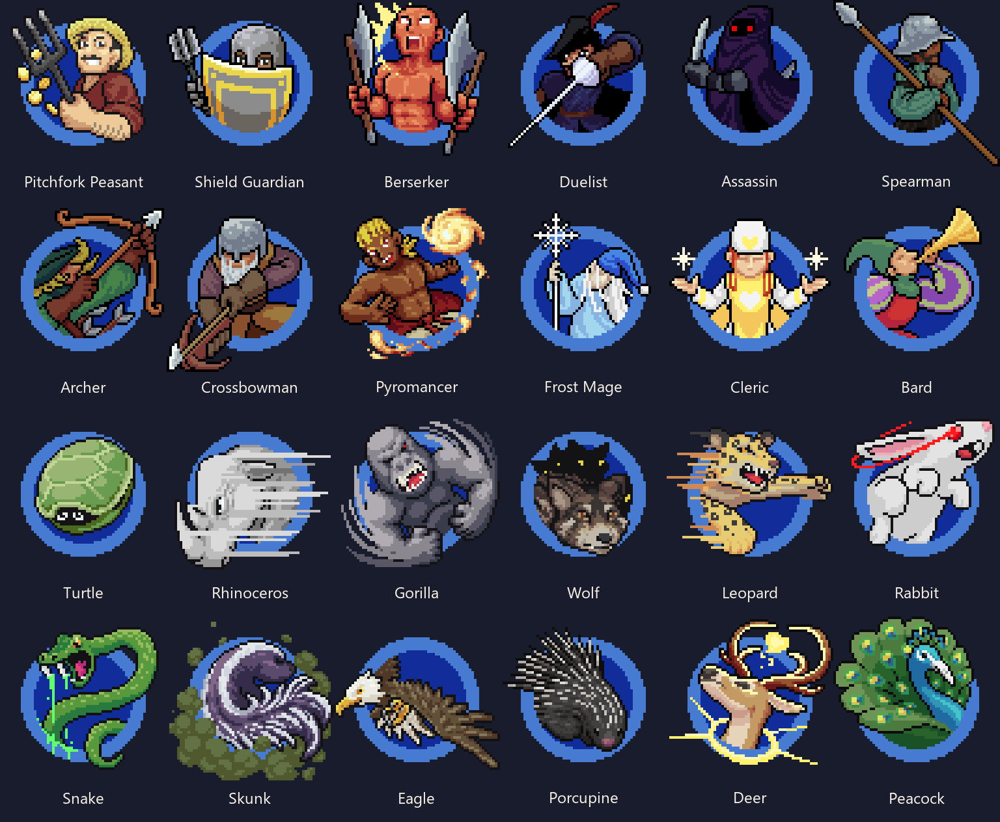
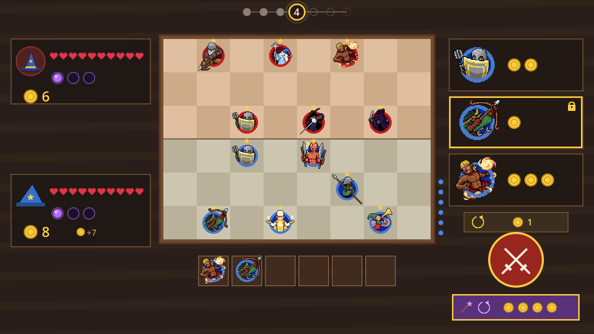

# Shapeshifter Duel - First Character Exploration

19 November 2026 · Working brief for 2D artists

**[Open the visual brief with embedded animations](Artist%20Brief.html).**
The HTML file contains its own images and videos, works offline, and can be shared as a single file. This note keeps the written brief available in the vault.

## The game

An auto-battler where two wizards rewrite the battle, one shapeshift at a time. Recruit a small band of fantasy fighters and place them on a board. They fight automatically; you intervene by transforming allies or enemies into a random new form. A Shield Guardian can become a Rabbit: a new body means a new combat role. The current game is a single-player duel against an AI wizard.

The intended mood is playful, mischievous and a little absurd. Super Auto Pets informs the atmosphere; Teamfight Tactics informs the board and automatic combat. Neither dictates the character style.

## Current characters

The prototype has 12 fantasy fighters and 12 animal forms. These drawings establish identities and roles; the visual style is open to exploration. Blue and red circles identify the two teams.

## Animation: an approach to explore together

For the prototype, I move, rotate and scale static drawings to keep the workload small. Dedicated character animations could be interesting too, with a different scope.

The [visual brief](Artist%20Brief.html#motion) includes recordings of the actual prototype:

- **Fight and bounce:** short lunges, hit flashes and hops on the bard's beat give combat rhythm and impact.
- **Change bodies:** golden light marks a friendly transformation; a purple vortex marks an enemy hex. The new form should read immediately.
- **Exit like a rocket:** defeated creatures spin off the board trailing smoke: exaggerated, comic defeat.

## Your first exploration

**Suggest a visual direction for the game, then try it out through a Shield Guardian and a Rabbit.** Armoured strength versus agility: a solid guardian and a quick, unexpectedly fierce rabbit. The rabbit should look less powerful, but still ready to fight. Keep their on-board size comparable so both remain easy to read. This is one possible transformation, not a fixed pair.

Please share:

1. **A few words on your art direction and animation.** What would suit the game's mood, stay manageable for a jam, and be fun for you to make? Would you keep the current animation approach or add a few simple character animations? No animation to produce.
2. **A visual reference.** A game screenshot, a few reference images or a small mock-up to explain your direction. Choose one format.
3. **A first take on the Guardian and the Rabbit.** One pose each, readable at gameplay size. Rough sketches are welcome.

**Suggested time: up to 1-2 hours; less is welcome.** Keep it light rather than polishing or expanding the scope. If another fantasy fighter / animal combination inspires you more, suggest it before starting.

**Open to exploration:** style, palette, proportions and expression, within a 2D heroic fantasy world. Top-down or slight perspective can be explored.

## Continuing together

This is a small game jam project: a chance to get to know each other and see if we enjoy working together, with no pressure to carry on afterwards.

If I'd like to use your work in the game, I'll talk it through with you first. And of course, if we decide to work together, you'll be credited on the game's itch.io page, as I've always done for my game jams.

Further context: [[Pitch]] · [[Art Direction]]. Reading the full design notes is not required for this exploration.
